# Integrating with WasaaChat: a reference mini-app

This repository is a **reference implementation for developers integrating their own apps with WasaaChat**. It is a
complete, working shop called VIVA that uses every integration a typical mini-app needs:

- **Mini-app sign-in** with launch codes (code2Session), so people are signed in the moment they open your app
- **Payments** from the WasaaChat wallet, verified on your server
- **Sign in with WasaaChat** on the web (OAuth 2.0 + OpenID Connect, authorization code with PKCE)
- **Webhooks** for payments and for people disconnecting your app

The guide below walks through each integration step by step, with the exact code from this repo. Read the steps,
open the files they point to, and copy what you need. The shop itself is only the example: the WasaaChat parts are
kept in a few clearly named files (see [Where to find each integration](#where-to-find-each-integration)) so you can
lift them into an app in any domain.

| Inside WasaaChat | Product page | Paid with the WasaaChat wallet |
| :---: | :---: | :---: |
| 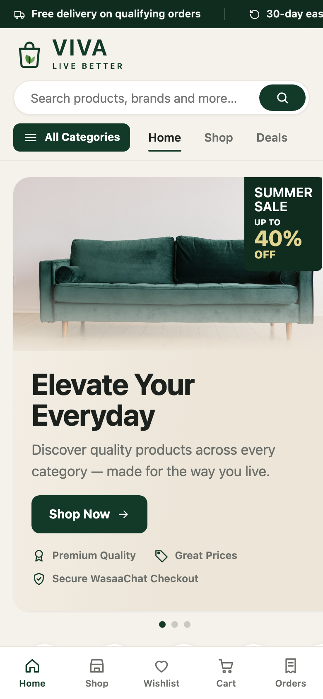 | 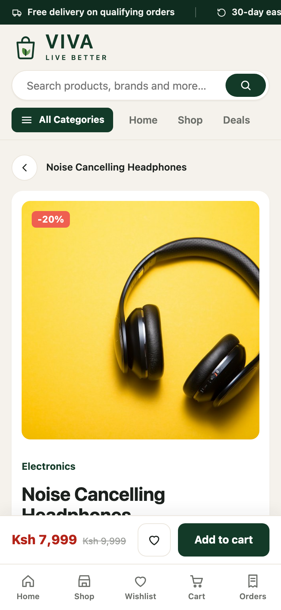 | 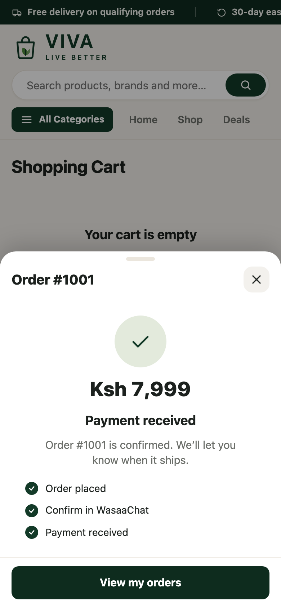 |

**Stack:** Bun · Express 5 · MySQL (Drizzle ORM) · Redis (BullMQ) for the backend; plain HTML, CSS and JavaScript
modules (no build step) for the shop in `public/wasaa/`.

## Where to find each integration

| Integration | Backend | Page (browser) | Guide |
| --- | --- | --- | --- |
| Launch codes (code2Session) | `src/services/wasaachat.service.ts` → `exchangeLaunchCode`, `loginWithLaunchCode`; `src/controllers/wasaa.controller.ts` | `public/wasaa/js/main.js`, `js/core/bridge.js` | [Section 5](#5-mini-app-sign-in-with-launch-codes-code2session) |
| Payments | `src/services/order.service.ts` → `prepareWasaPayment`; `wasaachat.service.ts` → `verifyPaymentIntent`, `confirmOrderPayment` | `js/features/checkout/payment.js` | [Section 6](#6-payments) |
| Sign in with WasaaChat (web) | `src/services/wasaachat-oauth.service.ts`, `src/controllers/oauth.controller.ts` | `js/core/web-auth.js` | [Section 7](#7-sign-in-with-wasaachat-on-the-web-oauth) |
| Payment webhook | `wasaachat.service.ts` → `verifyWasaSignature`, `handleWebhook` | — | [Section 8](#8-webhooks) |
| Deauthorize webhook | `src/services/wasaachat-deauthorize.service.ts` | — | [Section 8](#8-webhooks) |
| Sessions | `src/services/session.service.ts`, `src/middleware/auth.ts`, `src/utils/cookies.ts` | `js/core/api.js` | [Section 9](#9-sessions-and-sign-out) |
| Local bridge stand-in | — | `js/dev/mock.js` | [Section 2](#try-the-in-app-flow-without-wasaachat) |

Everything else (products, cart, orders, emails) is ordinary shop code; your app replaces it with its own.

## Contents

1. [How it fits together](#1-how-it-fits-together)
2. [Run it locally](#2-run-it-locally)
3. [Register the app in the WasaaChat developer console](#3-register-the-app-in-the-wasaachat-developer-console)
4. [Environment variables](#4-environment-variables)
5. [Mini-app sign-in with launch codes](#5-mini-app-sign-in-with-launch-codes-code2session)
6. [Payments](#6-payments)
7. [Sign in with WasaaChat on the web (OAuth)](#7-sign-in-with-wasaachat-on-the-web-oauth)
8. [Webhooks](#8-webhooks)
9. [Sessions and sign-out](#9-sessions-and-sign-out)
10. [Deploy](#10-deploy)
11. [Troubleshooting](#11-troubleshooting)
12. [Reference: routes and project layout](#12-reference)

WasaaChat's own documentation, which this project follows:
[Getting started](https://wasaachat.com/developers/getting-started) ·
[Launch codes](https://wasaachat.com/developers/launch-codes) ·
[Payments](https://wasaachat.com/developers/payments) ·
[Sign in with WasaaChat](https://wasaachat.com/developers/sign-in-with-wasaachat)

---

## 1. How it fits together

One backend serves the shop page, the JSON API, the OAuth redirects and the webhooks. The shop page decides how to sign
the shopper in from where it is running.

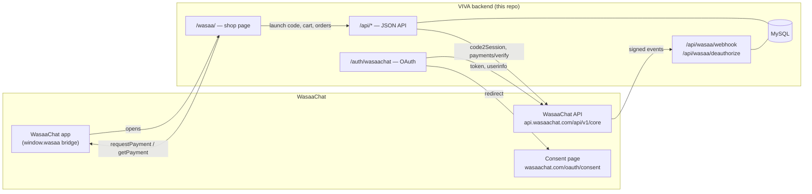

| Where the shop runs | How the shopper signs in | Can they pay? |
| --- | --- | --- |
| Inside the WasaaChat app | **Launch code** (code2Session), no button to press | Yes, with `wasaa.requestPayment` |
| Any browser tab | **Sign in with WasaaChat** button (OAuth Flow A) | No; the shop asks them to open VIVA in WasaaChat to pay |

Either way the shopper ends up as **the same user**: WasaaChat gives the mini-app an `open_user_id` and gives the web
sign-in a `sub`, and the two are the same value. VIVA stores it once, in `users.wasaa_open_user_id`.

## 2. Run it locally

**You need:** [Bun](https://bun.sh) 1.2+, MySQL 8, and Redis (for the email queue).

```bash
bun install
cp .env.example .env            # then fill it in, see section 4
bun run db:migrate              # create the tables
bun run db:seed                 # 8 categories and 12 products with photos
bun run dev                     # http://localhost:3000 → redirects to /wasaa/
bun run dev:worker              # optional: the email worker
```

### Try the in-app flow without WasaaChat

Open **http://localhost:3000/wasaa/?mock**. A local stand-in for the WasaaChat bridge (`public/wasaa/js/dev/mock.js`)
plays the host: it hands the page a launch code, approves payments and reports their status. It only switches on for
`localhost` with `?mock` in the URL, and never ships to WasaaChat.

| URL | What it simulates |
| --- | --- |
| `/wasaa/?mock` | Everything granted; payments succeed |
| `/wasaa/?mock=decline` | The shopper declines the payment |
| `/wasaa/?mock=nopay` | The shopper didn't grant `wallet.pay` at install; browsing works, checkout doesn't |

Open the browser console: every API call and bridge call is logged with its response, with secrets (`accessToken`,
`code`, `session_token`, `app_secret`) redacted.

### Tests

```bash
bun test            # 59 tests: launch codes, OAuth, webhooks, payments, email, proxy
bun run typecheck
```

## 3. Register the app in the WasaaChat developer console

Do this once, at [wasaachat.com/apps/developer](https://wasaachat.com/apps/developer) → **New app** (or your existing
app). The examples use `https://your-app.example.com`; use your own domain. The paths are this project's, so
change them if your routes differ.

| Console field | Value for this project |
| --- | --- |
| App URL (the mini-app) | `https://your-app.example.com/wasaa/` |
| Scopes the mini-app asks for | `profile.read`, `wallet.pay` |
| Payment webhook URL | `https://your-app.example.com/api/wasaa/webhook` |
| Privacy policy URL | `https://your-app.example.com/privacy` |
| App icon | Your square icon (this project's is `branding/viva-icon-light-1024.png`) |
| **Sign in with WasaaChat** → Enable | On |
| → Redirect URIs | `https://your-app.example.com/auth/wasaachat/callback` and, for development, `http://localhost:3000/auth/wasaachat/callback` |
| → Scopes | `profile` (`openid` is always included) |
| → Deauthorize URL | `https://your-app.example.com/api/wasaa/deauthorize` |
| → Test users | Anyone besides you who should sign in on the web before the app is live |
| **Getting paid** → Payee | A KYB-verified WasaaChat business you belong to. **Payments fail until it is approved.** |

The console shows these secrets **once**. Put each straight into your secret manager or `.env`:

| Secret shown by the console | Environment variable |
| --- | --- |
| App ID (also the OAuth `client_id`) | `WASAACHAT_CLIENT_ID` |
| App secret (also the OAuth `client_secret`) | `WASAACHAT_CODE_2_SESSION` |
| Payment webhook signing secret (`whsec_…`) | `WASAACHAT_PAYOUT_SIGNING_SECRET` |
| Deauthorize webhook secret (`whsec_…`) | `WASAACHAT_PAYOUT_DEAUTHORIZE_SECRET` |

> The mini-app, the payments and the web sign-in all use **the same app** and **the same app secret**. There is no
> separate "OAuth app".

## 4. Environment variables

The WasaaChat integration needs exactly these five. All of them come from the developer console (section 3):

```env
WASAACHAT_CLIENT_ID=                    # App ID (also the OAuth client_id)
WASAACHAT_CODE_2_SESSION=               # App secret: launch codes, payment verification, OAuth token exchange
WASAACHAT_PAYOUT_SIGNING_SECRET=        # whsec_… verifies the payment webhook
WASAACHAT_PAYOUT_DEAUTHORIZE_SECRET=    # whsec_… verifies the deauthorize webhook
WASAA_OAUTH_REDIRECT_URI=https://your-app.example.com/auth/wasaachat/callback   # exactly as registered
```

| Variable | Used by |
| --- | --- |
| `WASAACHAT_CLIENT_ID` | Launch-code exchange, `payments/verify`, Sign in with WasaaChat |
| `WASAACHAT_CODE_2_SESSION` | The same three. It is your app secret: keep it on the server only |
| `WASAACHAT_PAYOUT_SIGNING_SECRET` | `POST /api/wasaa/webhook` |
| `WASAACHAT_PAYOUT_DEAUTHORIZE_SECRET` | `POST /api/wasaa/deauthorize` |
| `WASAA_OAUTH_REDIRECT_URI` | Sign in with WasaaChat. Must match the registered redirect URI character for character |

Never commit `.env`; it is in `.gitignore`.

## 5. Mini-app sign-in with launch codes (code2Session)

Inside WasaaChat, nobody presses a sign-in button. The shopper already approved VIVA's permissions when they installed
it, so WasaaChat hands the page a one-time **launch code**, and the backend swaps it for the shopper's identity.

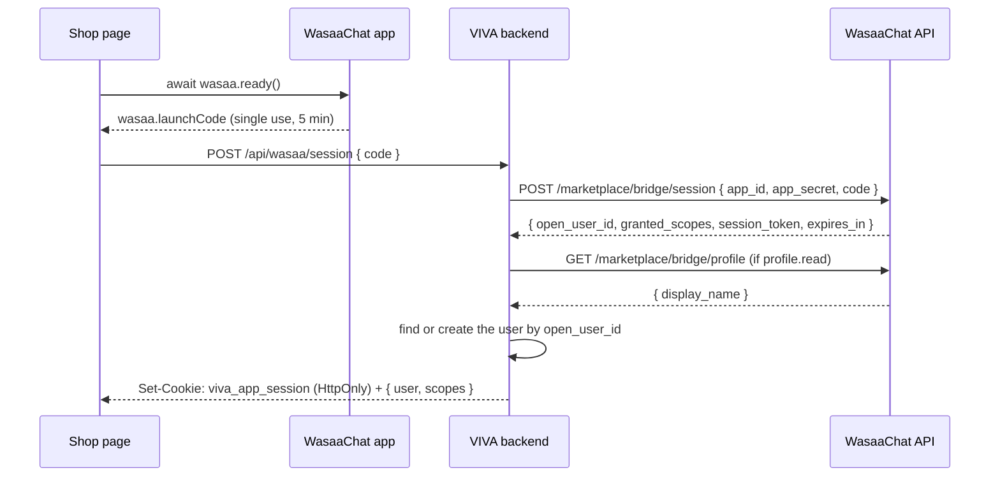

### Step 1 — Load the bridge

`public/wasaa/index.html` loads WasaaChat's bridge before the app code. It defines `window.wasaa`.

```html
<script src="https://wasaachat.com/sdk/wasaa-bridge.v2.js"></script>
<script src="./js/main.js" type="module"></script>
```

The page's Content-Security-Policy allows that script and lets WasaaChat frame the page (`src/app.ts`):

```ts
"default-src 'self'; script-src 'self' https://wasaachat.com; ... frame-ancestors 'self' https://wasaachat.com"
```

### Step 2 — Wait for the host, read the launch code, send it to the backend

`public/wasaa/js/main.js`:

```js
await callBridge("ready");                          // wasaa.ready()
const session = await api.session(launchCode());    // POST /api/wasaa/session { code: wasaa.launchCode }
```

Never send the launch code anywhere except your own backend, and never log it.

### Step 3 — Exchange the code with the app secret (backend)

`src/services/wasaachat.service.ts`:

```ts
export async function exchangeLaunchCode(code: string): Promise<LaunchSession> {
  const result = await postJson("/marketplace/bridge/session", {
    app_id: requireEnv("WASAACHAT_CLIENT_ID"),
    app_secret: requireEnv("WASAACHAT_CODE_2_SESSION"),
    code,
  });
  if (!result.ok || typeof result.json?.open_user_id !== "string") {
    throw new UnauthorizedError("Launch code was rejected; reopen the app");
  }
  return result.json as unknown as LaunchSession; // { open_user_id, granted_scopes, session_token, expires_in }
}
```

A used, expired or unknown code, and a wrong app secret, all come back as the same `APP_LAUNCH_TOKEN_INVALID` (401).
The fix in every case is for the shopper to reopen the app, which issues a new code.

### Step 4 — Find or create the user, and start a session

`loginWithLaunchCode` reads the display name (only if `profile.read` was granted; sign-in never fails on it), then
keys the user on `open_user_id`:

```ts
const session = await exchangeLaunchCode(code);
const displayName = session.granted_scopes.includes("profile.read")
  ? await fetchBridgeDisplayName(session.session_token)
  : null;
const user = await upsertWasaaUser(session.open_user_id, displayName);
return { user, scopes: session.granted_scopes, ...issueSession(user, session.expires_in) };
```

The controller (`src/controllers/wasaa.controller.ts`) puts VIVA's own session in an HttpOnly cookie, like WasaaChat's
examples. The page runs inside WasaaChat's frame, so the cookie is `SameSite=None; Secure; Partitioned`:

```ts
setCookie(req, res, APP_SESSION_COOKIE, result.accessToken, {
  sameSite: "None", partitioned: true, maxAgeSeconds: result.expiresIn,
});
```

### Step 5 — Respect the one-hour limit

WasaaChat's bridge session lasts **one hour and cannot be refreshed**, by design, so an uninstall or a revoked
permission takes effect. VIVA's session ends with it (`src/services/session.service.ts` caps it at `expires_in`). When
it ends, the shop asks the shopper to close and reopen the app; the cart is kept.

> **If the browser blocks the cookie.** Some browsers (mainly Safari) refuse cookies inside frames. Right after
> signing in, the page calls `GET /api/wasaa/me`; if that doesn't show the new session, it keeps the token in memory
> and sends it as `Authorization: Bearer …` instead. The shopper notices nothing.

## 6. Payments

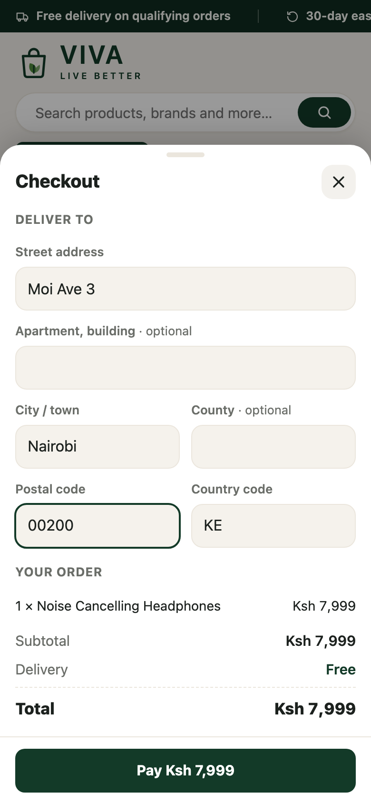

The shopper pays from their WasaaChat wallet on WasaaChat's own payment sheet. VIVA never sees their PIN or wallet.
**The page starts the payment; only the backend decides that an order is paid**, using the app secret.

**Before you start:** payments work only after a payee business is approved in the console (section 3). Until then
every request fails with `This app is not set up to accept payments.`

WasaaChat's rules that the code enforces:

- Amounts are **decimal strings in KES**, at most **KES 100,000** per payment. Checkout refuses bigger orders before
  creating them (`src/utils/money.ts`).
- `reference` is the purchase's idempotency key **forever**. VIVA makes a new one for each attempt,
  `order-<id>-<random>`, so a declined payment can be retried.
- Statuses: `pending`, `confirmed`, `paid`, `declined`, `expired`, `failed`, `refunded`.
- WasaaChat keeps an 8% fee; the shopper pays the order total.

<br clear="right">

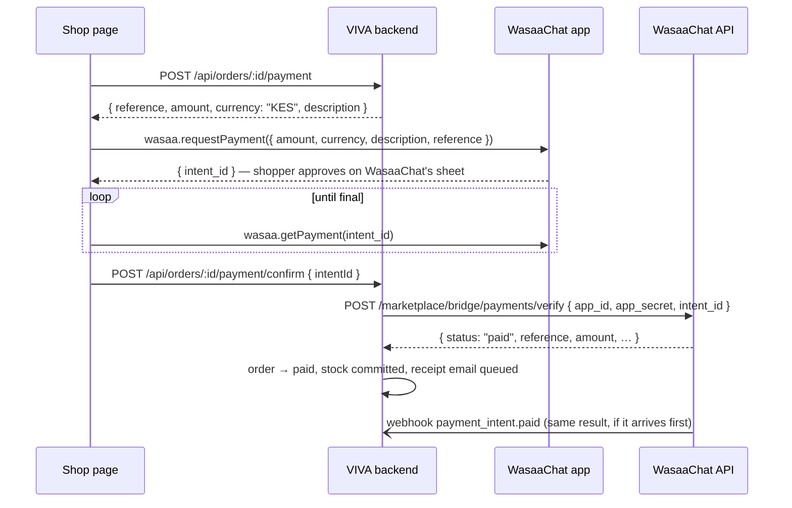

### Step 1 — Prepare the payment on the server

`src/services/order.service.ts`: only a `pending` order of the signed-in shopper can be paid, and each attempt gets a
fresh reference.

```ts
const reference = `order-${order.id}-${randomBytes(6).toString("hex")}`;
await orderRepository.updatePaymentReference(order.id, reference, tx);
return { orderId: order.id, reference, amount: order.total, currency: "KES", description: `VIVA order #${order.id}` };
```

### Step 2 — Ask WasaaChat to charge, from the page

`public/wasaa/js/features/checkout/payment.js`:

```js
const payment = await api.preparePayment(order.id);
const { intent_id } = await callBridge("requestPayment", {
  amount: payment.amount,          // "7999.00"
  currency: payment.currency,      // "KES"
  description: payment.description,
  reference: payment.reference,
});
```

Check `wasaa.can("wallet.pay")` first. If the shopper didn't grant it at install, VIVA lets them browse and shows how to
allow payments, instead of failing at checkout.

### Step 3 — Follow the status, then let the backend confirm

The page polls `wasaa.getPayment(intent_id)` to show progress. When it reads `paid`, it asks the backend to confirm:

```js
if (status === "paid") api.confirmPayment(order.id, intentId);
```

The backend **never trusts the page**. It asks WasaaChat directly and checks the payment belongs to this order
(`src/services/wasaachat.service.ts`):

```ts
const intent = await verifyPaymentIntent(intentId);          // payments/verify with the app secret
if (orderIdFromReference(intent.reference) !== order.id) {
  throw new BadRequestError("That payment is not for this order");
}
if (intent.status === "paid") await fulfilPaidIntent(intent);  // pending → paid, once
```

The `payment_intent.paid` webhook (section 8) does the same thing. Whichever arrives first marks the order paid; the
other finds it already paid and does nothing. If a second payment arrives for an order that is no longer awaiting
payment, it is recorded and logged as needing a refund.

| Payment received | My Orders |
| :---: | :---: |
|  | 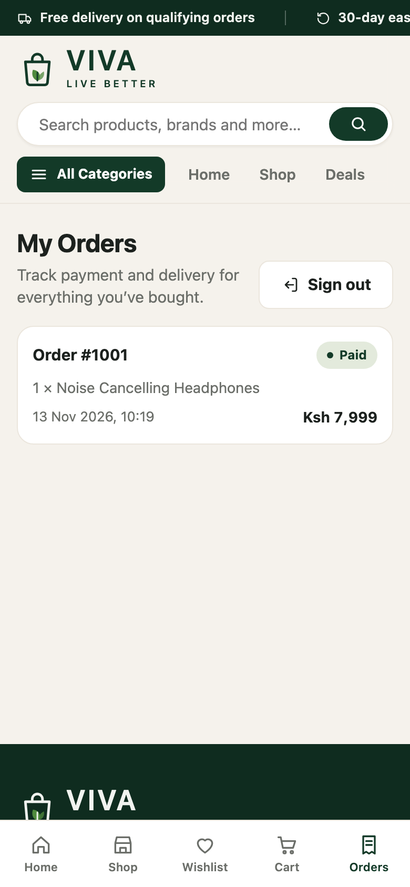 |

## 7. Sign in with WasaaChat on the web (OAuth)

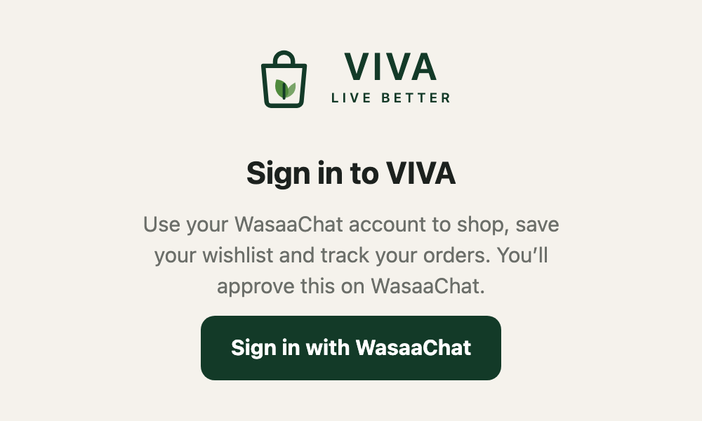

In a normal browser tab there is no bridge, so the shop shows a **Sign in with WasaaChat** button. It uses WasaaChat's
**Flow A**: authorization code with PKCE (S256), `state` and `nonce`, for a backend that keeps the client secret. The
app secret never reaches the browser.

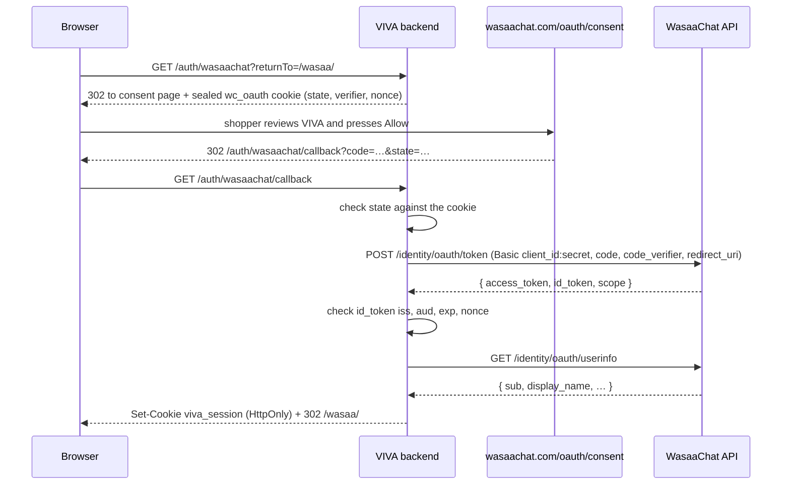

All of it is in `src/services/wasaachat-oauth.service.ts` and `src/controllers/oauth.controller.ts`.

### Step 1 — Send the shopper to the consent page

Three random values per sign-in: `state` (CSRF protection), a PKCE `code_verifier`, and a `nonce`. They are kept in a
short-lived cookie (10 minutes), encrypted with AES-256-GCM so the browser can neither read nor change them
(`src/utils/sealed.ts`).

```ts
const pending = {
  state: b64url(randomBytes(32)),
  verifier: b64url(randomBytes(48)),          // 64 characters, within PKCE's 43–128
  nonce: b64url(randomBytes(16)),
  returnTo: safeReturnTo(returnTo),           // only paths under /wasaa/, never another site
};
url.search = new URLSearchParams({
  client_id, redirect_uri, response_type: "code", scope: "openid profile",
  state: pending.state, nonce: pending.nonce,
  code_challenge: b64url(createHash("sha256").update(pending.verifier).digest()),
  code_challenge_method: "S256",
}).toString();
```

While the app is in **development**, only you and the test users listed in the console can sign in. Anyone else comes
back with `access_denied`, which the shop shows as "You didn't allow VIVA".

### Step 2 — Handle the callback

```ts
const pending = unseal(stateCookie);                   // gone or tampered → "expired"
if (query.state !== pending.state) throw ...;          // another browser or a forged link
if (query.error) throw new SignInDeclined(query.error); // access_denied → declined

const tokens = await redeemCode(query.code, pending.verifier);   // POST /identity/oauth/token
const sub = checkIdToken(tokens.id_token, pending.nonce);        // iss, aud, exp, nonce
const profile = await fetchUserInfo(tokens.access_token);        // GET /identity/oauth/userinfo
if (profile.sub !== sub) throw ...;
const user = await upsertWasaaUser(sub, profile.display_name ?? profile.name ?? null);
```

The token request authenticates with HTTP Basic (`client_id:client_secret`) and repeats the exact `redirect_uri`. The
ID token comes straight from WasaaChat over TLS, authenticated with the client secret, so per OpenID Connect Core
§3.1.3.7 VIVA checks its claims (issuer, audience, expiry, nonce) without fetching the JWKS.

### Step 3 — Keep the shopper signed in

The callback sets `viva_session`: HttpOnly, `SameSite=Lax`, Secure, valid for 7 days. The page asks
`GET /api/wasaa/me`, which answers `{ user, session: "web" }`, or `{ user: null, session: null }` when nobody is
signed in. That is a normal answer, not an error.

### Step 4 — When something goes wrong, say which step

The callback never shows a raw error. It sends the shopper back to `/wasaa/?signin=<result>&why=<code>`, and the page
shows a plain sentence with the code in brackets, so a failure on a server whose logs you can't see still tells you
which step broke:

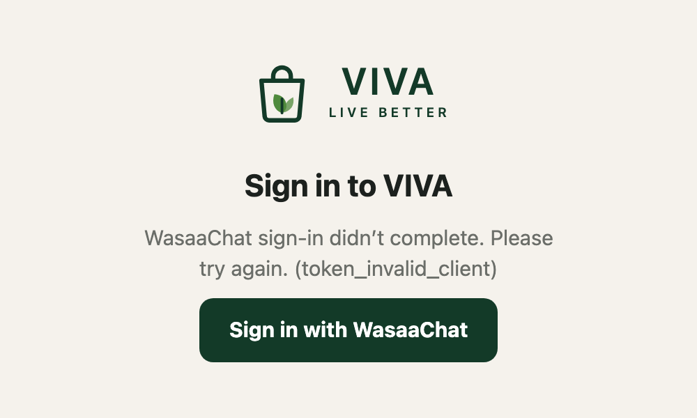

See [Troubleshooting](#11-troubleshooting) for what each code means.

## 8. Webhooks

Both webhooks read the **raw request body** (kept by the JSON parser in `src/app.ts`), because the signature is computed
over the exact bytes. Opening either URL in a browser returns `405 Method Not Allowed`; that is expected.

| | Payment webhook | Deauthorize webhook |
| --- | --- | --- |
| URL | `POST /api/wasaa/webhook` | `POST /api/wasaa/deauthorize` |
| Secret | `WASAACHAT_PAYOUT_SIGNING_SECRET` | `WASAACHAT_PAYOUT_DEAUTHORIZE_SECRET` |
| Signature header | `X-Wasaa-Signature: t=<unix>,v1=<hex>` | `X-Wasaa-Timestamp: <unix>` and `X-Wasaa-Signature: sha256=<hex>` |
| Signed text | `"<t>.<raw body>"`, HMAC-SHA256 | `"<timestamp>.<raw body>"`, HMAC-SHA256 |
| Clock tolerance | 5 minutes | 5 minutes |
| Events | `payment_intent.paid`, `.refunded`, `.declined`, `.expired`, `.failed`, `payout.*`, `webhook.test` | `app.deauthorized` |
| Duplicates | Ignored by `delivery_id` | Ignored |

Signatures are compared in constant time (`timingSafeEqual`):

```ts
const expected = createHmac("sha256", secret).update(`${timestamp}.${rawBody}`).digest("hex");
return expected.length === received.length && timingSafeEqual(Buffer.from(expected), Buffer.from(received));
```

**Payment events are never trusted on their own.** For `payment_intent.paid` and `.refunded`, VIVA calls
`payments/verify` with the app secret and acts on WasaaChat's answer, not on the webhook body.

**Deauthorize** fires when someone removes VIVA from their connected apps in WasaaChat. VIVA checks the event is for
its own `client_id`, then records the time in `users.web_sessions_revoked_at`. Every web session issued before that
moment stops working immediately.

## 9. Sessions and sign-out

| | Inside WasaaChat | On the web |
| --- | --- | --- |
| Started by | Launch code (section 5) | OAuth callback (section 7) |
| Cookie | `viva_app_session`, `SameSite=None; Secure; Partitioned` | `viva_session`, `SameSite=Lax; Secure` |
| Lasts | Up to 1 hour, the bridge session's `expires_in` | 7 days |
| Ends early when | The shopper signs out | The shopper signs out, or disconnects VIVA in WasaaChat |
| After it ends | "Close and reopen the shop" | "Sign in again" |

**Sign out** is on the My Orders page. It calls `POST /api/wasaa/logout`, which clears both cookies, removes the
wishlist and saved address from the device, and remembers that the shopper signed out, so a reload doesn't sign them
straight back in. Inside WasaaChat it then closes the mini-app with `wasaa.close()`.

The auth middleware (`src/middleware/auth.ts`) reads the session from, in order: a `Bearer` header, the in-app cookie,
then the web cookie.

## 10. Deploy

What any WasaaChat integration needs in production:

- **HTTPS.** The session cookies are `Secure`, and WasaaChat shows your page inside its app and inside a frame on
  wasaachat.com.
- **Let WasaaChat frame your page.** Send `Content-Security-Policy: frame-ancestors 'self' https://wasaachat.com` and
  no `X-Frame-Options` on the mini-app's pages (see `src/app.ts`).
- **Keep the secrets on the server.** The app secret and both webhook secrets belong in your secret manager or
  environment, never in the page or in git.
- **Behind a proxy or CDN,** tell your framework how many hops to trust so rate limits and logs see the user's IP.
  This project uses `app.set("trust proxy", 1)` for one hop.
- **Run migrations before the new version starts.** This project uses `bun scripts/migrate.ts` (needs only
  `DATABASE_URL`). The `Dockerfile` builds a production image.

Before going live, check:

- [ ] Every WasaaChat variable from section 4 is set in production, with the real secrets
- [ ] The redirect URI in the console matches `WASAA_OAUTH_REDIRECT_URI` character for character
- [ ] The payee business is approved ("can accept payments: yes")
- [ ] The app icon and privacy policy are approved, and Sign in with WasaaChat has passed go-live review
- [ ] The webhook URLs answer `405` to a browser `GET`, and a test event from the console is received

## 11. Troubleshooting

**In-app**

| What you see | Cause | Fix |
| --- | --- | --- |
| "Please reopen the shop" | The launch code was used, expired (5 min), or the app ID/secret is wrong | Reopen the app. If it keeps happening, check `WASAACHAT_CLIENT_ID` and `WASAACHAT_CODE_2_SESSION` |
| "Your session has ended" | The one-hour bridge session ended | Close and reopen the shop; the cart is kept |
| "This app is not set up to accept payments." | No approved payee business | Console → Getting paid → nominate a KYB-verified business and wait for approval |
| "Allow payments for this app…" | The shopper didn't grant `wallet.pay` | They allow it in the app's permissions in WasaaChat |

**Web sign-in.** The code in brackets on the sign-in screen tells you the step:

| Code | Meaning | Fix |
| --- | --- | --- |
| `declined` message, no code | The shopper pressed Cancel, or isn't a test user while the app is in development | Add them as a test user, or go live |
| `expired` message | The sign-in took over 10 minutes, or started in another browser | Try again |
| `invalid_request`, `invalid_scope` | WasaaChat's consent page refused the request | Copy the response of `POST /identity/oauth/authorize` from DevTools → Network; its `message` names the problem (see the note below) |
| `state_mismatch` | The response doesn't belong to this browser's sign-in | Try again; if repeated, check that nothing strips cookies on `/auth/wasaachat` |
| `token_invalid_client` | Wrong `WASAACHAT_CLIENT_ID` or `WASAACHAT_CODE_2_SESSION` on the server | Fix the deployment's environment |
| `token_invalid_grant` | Code used or expired, or `WASAA_OAUTH_REDIRECT_URI` differs from the registered URI | Make them match exactly |
| `id_token_iss` | The ID token was issued by a different WasaaChat environment | Check you registered the app on production WasaaChat |
| `id_token_aud`, `id_token_nonce`, `id_token_exp` | The ID token isn't for this app or this sign-in | Try again; check server clock |
| `userinfo_<status>` | WasaaChat's userinfo endpoint failed | Try again |
| `save_user` | Database error while saving the user | Check the database and that migrations ran |
| `timeout`, `server` | WasaaChat didn't answer in time, or an unexpected error | Check the server log line "Sign in with WasaaChat failed" |

The reason codes are this project's, not WasaaChat's. Adding something similar to your own callback is worth it: on a
server whose logs you can't see, it is the quickest way to find which step failed.

> **Known issue (November 2026).** WasaaChat's consent page currently leaves `response_type` out of the request it
> sends when the user presses **Allow**, so every web sign-in comes back as `invalid_request` with the message
> `response_type must be "code".` If you see this, your request is not the problem; the fix is on WasaaChat's side
> and has been reported. Mini-app sign-in with launch codes is not affected.

## 12. Reference

### Routes

| Method and path | Auth | What it does |
| --- | --- | --- |
| `GET /` | — | Redirects to `/wasaa/` |
| `GET /wasaa/*` | — | The shop page and its assets |
| `GET /privacy` | — | Redirects to the privacy policy |
| `POST /api/wasaa/session` | — | Launch code → in-app session |
| `GET /api/wasaa/me` | optional | `{ user, session: "app" \| "web" \| null }` |
| `POST /api/wasaa/logout` | — | Clears both session cookies |
| `POST /api/wasaa/webhook` | signature | Payment and payout events |
| `POST /api/wasaa/deauthorize` | signature | `app.deauthorized` |
| `GET /auth/wasaachat` | — | Starts Sign in with WasaaChat |
| `GET /auth/wasaachat/callback` | — | Finishes it |
| `GET /api/categories`, `GET /api/products`, `GET /api/products/:slug` | — | Catalogue |
| `GET/POST/PATCH/DELETE /api/cart…` | session | Cart |
| `POST /api/orders/checkout` | session | Creates a pending order |
| `GET /api/orders`, `GET /api/orders/:id` | session | Orders |
| `POST /api/orders/:id/payment` | session | Prepares a payment (new reference) |
| `POST /api/orders/:id/payment/confirm` | session | Verifies with WasaaChat and confirms |
| `POST /api/orders/:id/cancel` | session | Cancels a pending order |

### Project layout

```
src/
  app.ts                          Express app: CSP, trust proxy, routes, static shop
  routes/                         wasaa.routes.ts (session, me, logout, webhooks), oauth.routes.ts, orders, cart, …
  controllers/                    wasaa.controller.ts, oauth.controller.ts, order.controller.ts, …
  services/
    wasaachat.service.ts          code2Session, payments/verify, payment webhook, order fulfilment
    wasaachat-oauth.service.ts    Sign in with WasaaChat (PKCE, token, ID token, userinfo)
    wasaachat-deauthorize.service.ts
    session.service.ts            in-app session length and cookie
    order.service.ts              checkout, payment preparation, KES 100,000 limit
  middleware/auth.ts              Bearer / app cookie / web cookie → req.user
  utils/cookies.ts, sealed.ts     cookie helpers; AES-256-GCM sealed state cookie
  models/schema.ts                Drizzle schema (users.wasaa_open_user_id, web_sessions_revoked_at, …)
drizzle/                          SQL migrations
public/wasaa/
  index.html                      loads wasaa-bridge.v2.js, then js/main.js
  js/main.js                      start-up: which sign-in to use
  js/core/                        api.js, bridge.js, web-auth.js, errors.js, logger.js, storage.js
  js/features/                    home, shop, product, cart, checkout (payment.js), orders, wishlist, account
  js/dev/mock.js                  local WasaaChat bridge stand-in (?mock)
  privacy.html                    privacy policy
scripts/                          migrate.ts, seed.ts
tests/                            unit and integration tests (bun test)
branding/                         app icons for the console
docs/images/                      screenshots in this README
```
